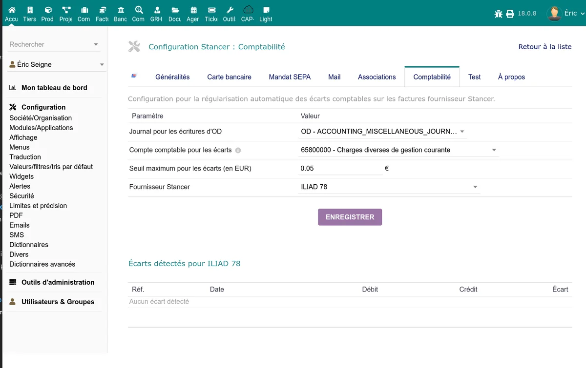

# Accounting

The Stancer module integrates accounting management tools to track fees, detect discrepancies between Stancer and Dolibarr amounts, and regularise them. The configuration is done in the **Accounting** tab of the administration page.

## Fee recording

The Stancer fee (commission) recording mode is defined in the [general configuration](/stancer/configuration) ("Fee recording" setting). Three modes are available:

- **None**: fees are not recorded in the bank transactions.
- **Per payout**: fees are recorded as a single line at each payout. This is the most common mode.
- **Per payment**: each payment generates an individual fee transaction on the bank account.

## Discrepancy detection and regularisation

Discrepancies can appear between the amounts recorded in Dolibarr and the actual amounts at Stancer, notably because of rounding or unrecorded fees. The Accounting tab provides a tool to detect and regularise them.

### Configuration

| Setting | Description |
|---------|-------------|
| Misc. operations journal | Accounting journal used for regularisation transactions (miscellaneous operations) |
| Discrepancy account | Accounting account to record discrepancies (e.g.: 658 -- Miscellaneous current management expenses) |
| Discrepancy threshold | Minimum amount (in EUR) below which discrepancies are not reported. Allows ignoring centime discrepancies |
| Stancer supplier | Dolibarr supplier record corresponding to Stancer, used for fee booking |

> **Note:** the Stancer supplier must have a supplier auxiliary account configured for the accounting transactions to be correctly matched.

### Usage

The accounting page displays the list of detected discrepancies between Stancer payouts and Dolibarr bank transactions.

For each discrepancy:

1. The module displays the payout concerned, the expected amount and the recorded amount.
2. A **Regularise** button allows automatically creating a misc. operations (OD) transaction to fill the gap.
3. The transaction is posted to the configured discrepancy account.

If no discrepancy is detected, a confirmation message is displayed.

## Bank transfers

During payout synchronisation, the module automatically creates transfer transactions between the Stancer bank account (transit account) and your main bank account. These transfers appear in the statements of both bank accounts in Dolibarr.

The transfer amount corresponds to the net payout amount (after fee deduction, according to the chosen recording mode).

## Payout import and verification

The **Payout import/verification** page (accessible from the menu) allows:

- Comparing the payouts recorded in Dolibarr with the Stancer API data
- Identifying missing payouts or inconsistent amounts
- Correcting labels and dates on the main bank account
