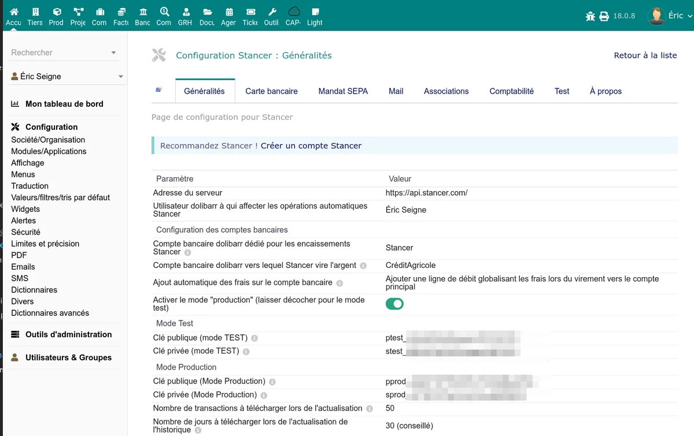
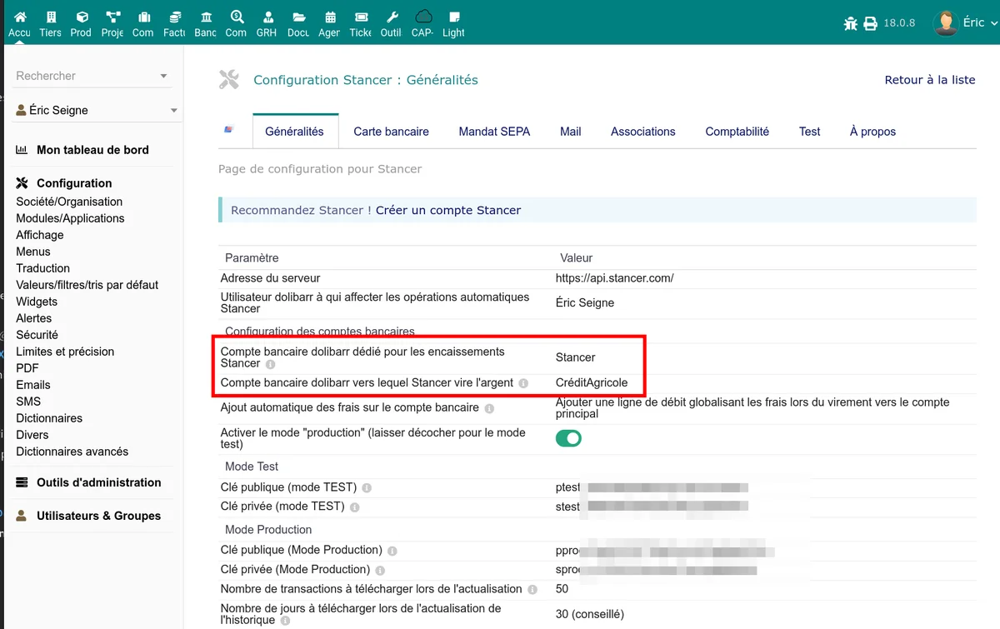

# Configuration

After enabling the module, go to **Home > Setup > Modules > Stancer** (gear icon) to access the configuration page. The **General** tab contains the essential settings.

## API keys

Stancer provides two sets of API keys: one for test mode and one for production mode.

### Test mode

| Setting | Description |
|---------|-------------|
| Test public key | Key starting with `ptest_` -- used on the client side (payment page) |
| Test private key | Key starting with `stest_` -- used on the server side (API calls) |

### Production mode

| Setting | Description |
|---------|-------------|
| Production public key | Key starting with `pprod_` |
| Production private key | Key starting with `sprod_` |

Get your keys from your [Stancer dashboard](https://manage.stancer.com/).

> **Warning:** do not confuse public and private keys. The private key must never be exposed publicly.

## Production / test mode

The **Production Mode** setting determines which set of API keys is used:

- **No** (default): test mode. Payments are not real. Use this mode for your trials.
- **Yes**: production mode. Payments are real and collected.

> **Note:** in test mode, the payout list is not available (the Stancer API does not provide payout data in test mode).

## Bank accounts

### Bank account for collections

Select the Dolibarr bank account on which payments received via Stancer will be recorded. By default, the "STANCER" account automatically created at installation is offered.

This account serves as a **transit account**: funds are recorded there when the payment is received, before being transferred to your main bank account at payout.

### Main bank account for payouts

Select your main bank account (the one to which Stancer transfers the payouts). When a payout is synchronised, the module creates a transfer transaction from the Stancer account to this account.

## Fee recording

The **Fee recording** setting controls how Stancer commissions are booked:

| Option | Behaviour |
|--------|-----------|
| None | Fees are not recorded on the bank account |
| Per payout | Fees are recorded as a single line at each payout |
| Per payment | Fees are recorded individually for each payment |

## User for automated actions

Select the Dolibarr user account that will be used for the module's automated operations (marking invoices as paid, creating bank transactions, sending emails). Choose a user with the necessary permissions on invoices and the bank.

## Synchronisation settings

### Number of days to synchronise

Determines the depth of the history retrieved during a synchronisation with the Stancer API. Default value: **31 days**.

Available values: 10, 20, 30, 40, 50, 60, 90, 365 or 730 days.

> **Tip:** a value of 30 to 60 days is enough for current use. Increase it only if you need to retrieve an older history (first installation, catch-up).

### Number of items per synchronisation

Maximum number of items retrieved per API call. Default value: **100**.

Available values: 10, 20, 30, 50 or 100.

## Monthly SME subscription

This information field allows entering the amount of the monthly Stancer subscription (default: 18 EUR). It is used in the fee estimates displayed in the dashboard.

## Payment from quotes

The **Quotes** section allows configuring online payment directly from a quote (sales proposal):

- **Automatically create the invoice when a quote is paid**: if enabled, the module automatically generates the corresponding invoice when the customer pays a quote online.

## Cleaning test data

When you switch from test mode to production mode, a **Clean test data** button appears. It deletes the payments, payouts and refunds recorded in test mode to start from a clean base.

## Next steps

Once the general configuration is done, enable the desired payment methods:

- [Credit card payments](/stancer/paiements-cb)
- [SEPA direct debits](/stancer/sepa)
- [Email notifications](/stancer/notifications)
