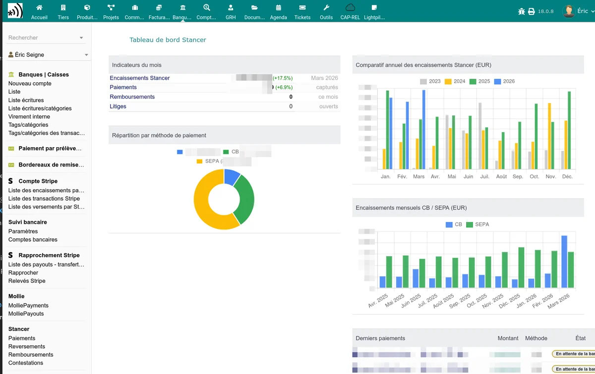

# Stancer for Dolibarr

The Stancer module integrates the [Stancer](https://www.stancer.com/) payment platform into your Dolibarr ERP. It allows you to collect payments from your customers by **credit card** and by **SEPA direct debit**, directly from your invoices, orders and quotes.

## Main features

**Credit card payments**

- Sending online payment links to your customers
- Secure public payment page (3D Secure)
- Partial payment from orders and quotes
- Automatic confirmation and marking of the invoice as paid

**SEPA direct debits**

- Public IBAN entry page for your customers
- Automatic creation of the SEPA mandate (PDF)
- IBAN check via SEPAMail (France and Italy)
- Automatic direct debit of overdue invoices
- SEPA rejection handling with automatic invoicing of fees
- Optional integration with UptoSign for electronic signature of the mandate

**Tracking and synchronisation**

- Dashboard with key indicators (collections, payments, refunds, disputes)
- Tracking lists: payments, payouts, refunds, disputes
- Synchronisation with the Stancer API (manual or via a scheduled task)
- Stancer tab on each third-party record

**Notifications**

- Automatic payment confirmation emails
- Error and SEPA rejection notifications to the customer and the administrator
- Automatic reminders in case of payment failure

**Accounting**

- Recording of Stancer fees on the bank account
- Detection and regularisation of accounting discrepancies
- Payout management

**Memberships**

- Online payment of membership fees and donations

## Prerequisites

- **Dolibarr** version 15.0 or higher
- **PHP** version 7.4 or higher
- A **Stancer account** with your API keys (sign up on [stancer.com](https://www.stancer.com/))
- The **Bank** and **Direct debit** modules enabled in Dolibarr

## Getting started

1. [Install the module](/stancer/installation)
2. [Configure your API keys and your bank account](/stancer/configuration)
3. [Enable credit card payments](/stancer/paiements-cb) and/or [SEPA direct debits](/stancer/sepa)
4. [Track your payments](/stancer/suivi-paiements)
