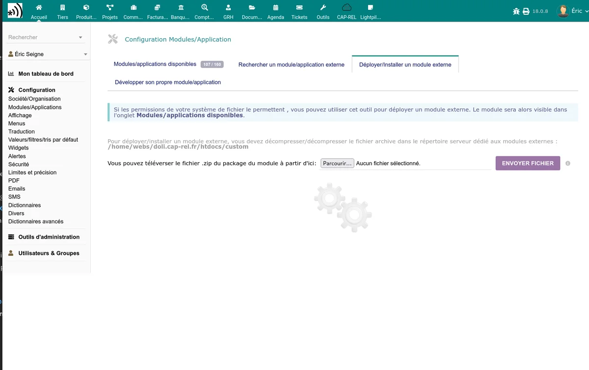

# Installation

## Download

Download the module from its page on the DoliStore. You get a `.zip` archive containing the Stancer module.

## Installation

1. Log in to Dolibarr with an administrator account.
2. Go to **Home > Setup > Modules/Applications**.
3. Click **Deploy/Install an external module**.
4. Select the downloaded `.zip` archive and validate.

Dolibarr automatically extracts the files into the custom modules directory.

## Enabling

1. Stay in **Home > Setup > Modules/Applications**.
2. Find "Stancer" in the module list (category **Interfaces**).
3. Click the toggle to enable the module.

## Post-installation checks

During enabling, the module automatically performs several operations:

- **Creating the tables** in the database to store payments, payouts and refunds.
- **Creating a "STANCER" bank account** which will serve as a transit account for received payments.
- **Generating a security token** for the public payment pages (if none exists).

Check that these elements are in place:

1. Go to **Bank > Bank accounts** and confirm the presence of the "STANCER" account.
2. Click the gear icon next to the module to access the [configuration](/stancer/configuration).

## Required modules

The Stancer module requires the prior enabling of two Dolibarr modules:

- **Bank** -- bank account and transaction management
- **Direct debit** -- support for SEPA direct debit orders

If these modules are not enabled, the Stancer module cannot be enabled.

## Permissions

The module adds two permissions to configure in **Home > Setup > Users > Permissions**:

| Permission | Description |
|------------|-------------|
| Read Stancer data | Read access to the lists of payments, payouts, refunds and disputes |
| Create/modify Stancer data | Access to actions: refresh, refund, SEPA mandate management |

Assign these permissions to the users or groups concerned.

## Update

To update the module:

1. Download the new version from the DoliStore.
2. Install it via **Home > Setup > Modules/Applications > Deploy/Install an external module**.
3. Disable then re-enable the module to apply the database updates and register the new hooks and permissions.

> **Warning:** back up your database before any update.

## Uninstalling

To uninstall the module:

1. Go to **Home > Setup > Modules/Applications**.
2. Disable the Stancer module by clicking the toggle.

Disabling keeps the data in the database. The "STANCER" bank account and the associated transactions are not deleted.
