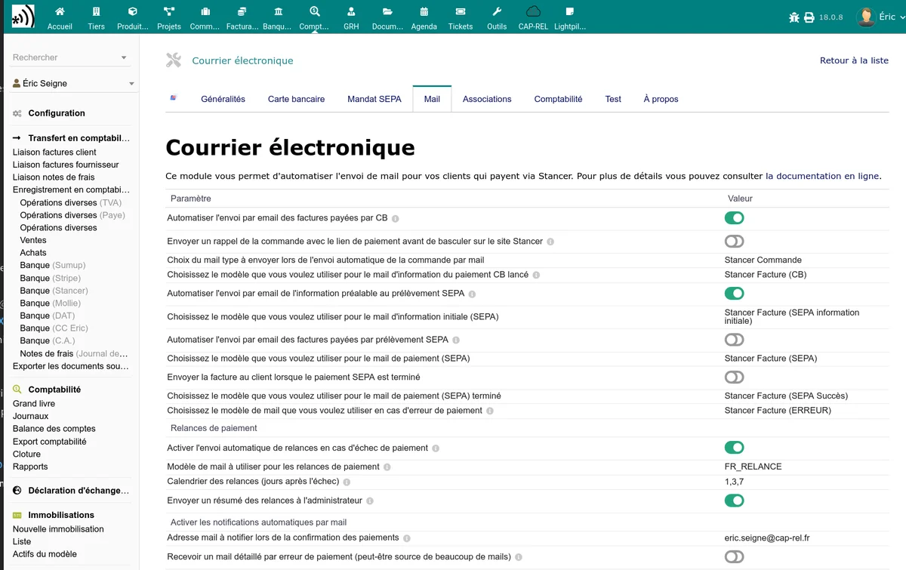

# Email notifications

The Stancer module can send automatic emails to your customers and your administrators depending on payment events. The configuration is done in the **Mail** tab of the administration page.

## Administrator notifications

### Payment and payout notifications

| Option | Description |
|--------|-------------|
| Automatic notifications | Enables the global sending of notification emails |
| Payment notification | Email sent to the administrator for each payment received |
| Payout notification | Email sent to the administrator for each payout made |

Enter the destination email address for these notifications. You can indicate several addresses separated by commas.

## Customer emails -- Credit card

### CB payment confirmation

When a customer pays by credit card, the module can automatically send them a confirmation email. Two options are offered:

| Option | Description |
|--------|-------------|
| Automatic sending of the invoice by email | Sends the invoice PDF to the customer after a successful CB payment |
| Email template | Dolibarr template used for sending the invoice (configurable in the Dolibarr email templates) |

### CB payment confirmation on order

In the same way, for payments made on an order:

| Option | Description |
|--------|-------------|
| Automatic sending after order payment | Sends a confirmation email to the customer |
| Order email template | Dolibarr template used for sending |

## Customer emails -- SEPA

Several emails are configurable for the SEPA life cycle:

| Option | Description |
|--------|-------------|
| SEPA information email | Email sent to the customer to inform them of an upcoming direct debit (prior notification) |
| SEPA direct debit email | Email sent to the customer when the direct debit is issued |
| SEPA paid email | Email sent to the customer after confirmed collection of the direct debit |

## Error notification

| Option | Description |
|--------|-------------|
| Payment error email | Email sent to the customer and/or the administrator in case of payment failure |

When the customer comes back to the payment page after a Stancer refusal (status refused, failed, expired or disputed), they receive this email at each refused attempt. A simple communication error with Stancer, which says nothing about the payment, does not trigger it.

The administrator is only notified once per payment and per status of a payment in error, even if the daily synchronisation finds it again several days in a row.

## SEPA rejection emails

When a SEPA direct debit is rejected, the module automatically sends an email to the customer (if configured in the SEPA tab) and to the address configured in the **SEPA notification email** field.

The rejection email contains:

- The reference of the invoice concerned
- The amount of the rejected direct debit
- The rejection reason (ISO 20022 code translated into plain language)
- Any rejection fees invoiced

## Automatic sending of invoices at validation

The module can email the invoice to the customer as soon as it is validated, whatever the payment method (cheque, transfer, cash, card, SEPA...). A grace delay is configurable to leave a human time to send the invoice manually with a covering message, before the automatic sending kicks in.

| Setting | Description |
|---------|-------------|
| Email the invoice at validation | Enables automatic sending at each validation |
| Email template | Dolibarr template used for sending |
| Delay before automatic sending (in hours) | Number of hours to wait after validation. 0 = immediate sending. Typical value: 24 (sending the next day if nobody did anything) |

How it works with a delay > 0:

- At invoice validation, the module records a scheduled sending (visible in the Stancer dashboard).
- During the delay, you can send the invoice manually with your own message: the automatic sending will be cancelled.
- If the invoice goes back to draft, is deleted or abandoned during the delay, the automatic sending is also cancelled.
- If nothing is done, the automatic sending is triggered by the dedicated [scheduled task](/stancer/taches-automatiques) (run every hour).

> **Tip:** a "Scheduled invoice sendings" view is available in the Stancer dashboard to track invoices whose sending is still pending. Overdue deadlines appear in red there.

## Automatic reminders

The module can send automatic reminders to customers whose payment failed (statuses `failed`, `refused`, `expired`, `disputed`). The system manages three configurable reminder levels:

- **Soft reminder** (default D+7) -- first reminder after the failure
- **Firm reminder** (default D+14) -- second reminder
- **Monthly reminders** -- sent every 30 days or so, up to 6 months after the failure

| Setting | Description |
|---------|-------------|
| Enable reminders | Enables automatic sending of reminders |
| Default mail template | Template used as a fallback if no specific template is configured for a level |
| Template for the 1st reminder (soft) | Template used for the first reminder (default D+7). If empty, the default template is used |
| Template for the 2nd reminder (firm) | Template used for the second reminder (default D+14). If empty, the default template is used |
| Template for monthly reminders | Template used for the following reminders (monthly, up to 6 months). If empty, the default template is used |
| Reminder schedule | Comma-separated list of days after the failure for each reminder. Default: `7,14,44,74,104,134,164` (D+7 soft, D+14 firm, then monthly up to about 6 months) |
| Administrator summary | Sends a summary of the reminders sent to the administrator |

The level (soft, firm, monthly) is automatically determined from the rank of the reminder in the schedule: the first reminder is of type soft, the second of type firm, and all the following ones of type monthly. The rank depends only on the position in the list, not on the number of configured days.

> **Automatic invoice reopening:** as soon as a payment is detected as failed (`failed`, `refused`, `expired`, `disputed`), if the invoice had been marked as paid, it is automatically reopened by the module and a reverse payment is created to restore the balance due. A trace is added in the invoice event history.

Reminders are executed by the dedicated [scheduled task](/stancer/taches-automatiques).

## Variables available in emails

Stancer email templates use the standard Dolibarr substitution variables, plus a few specific variables:

- `__AMOUNT__`: payment amount
- `__PAYMENT_ID__`: Stancer payment identifier
- `__INVOICE_REF__`: invoice reference
- `__ORDER_REF__`: order reference
- `__CUSTOMER_NAME__`: customer name

> **Tip:** configure your email templates in **Home > Setup > Emails > Email templates** to customise the content of the messages sent by the module.

## BCC for archiving

All emails sent by the Stancer module (administrator notifications, customer emails, reminders, summaries) respect the global Dolibarr setting **BCC for all outgoing emails**.

To archive a copy of each email to a dedicated address:

1. Go to **Home > Setup > Emails**.
2. Fill in the **BCC addresses for all outgoing emails** field (key `MAIN_MAIL_AUTOCOPY_TO`) with your archiving address.
3. Save.

Adding the BCC is automatic on all module emails, there is nothing to configure on the Stancer side.

## "Bank transfer completed" notification

When a transfer (payout) is synchronised from Stancer, a "Bank transfer completed" email is sent to the administrator notification address. **This email is sent only once per payout**, even if the synchronisation scheduled task runs every day and comes across the same payout again within the last 31 days window.

The module tracks the sending via an event (ActionComm) attached to the destination bank account, which prevents duplicates.
