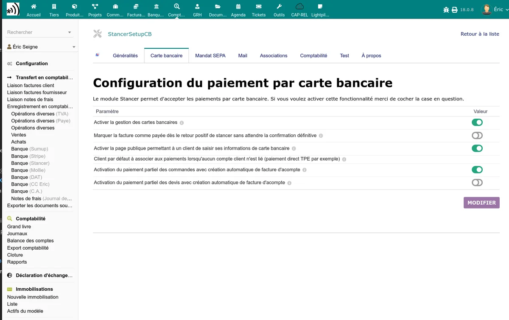

# Credit card payments

The Stancer module allows your customers to pay by credit card from a secure online payment link. The configuration is done in the **Credit card** tab of the module administration page.

## Enabling

Enable the **Enable credit card payment** option to make this payment method available. Once enabled, card payment buttons appear on invoice, order and quote records.

## Public payment page

The **Enable public CB payment page** option creates a page accessible without logging in to Dolibarr. Your customers access it via a secure link containing a unique token.

The payment flow is as follows:

1. The customer receives a payment link (by email or from the PDF document).
2. They are redirected to the Stancer payment page (hosted by Stancer, 3D Secure secured).
3. They enter their card details and validate.
4. They are redirected to a confirmation page in Dolibarr.
5. The invoice is automatically marked as paid.

## Partial payment

Two options allow authorising the payment of an amount lower than the total:

| Option | Description |
|--------|-------------|
| Partial payment from orders | Allows the customer to pay a partial amount on an order |
| Partial payment from quotes | Allows the customer to pay a partial amount on a quote (deposit) |

When partial payment is enabled, the customer can change the proposed amount on the payment page.

## Automatic marking as paid

The **Mark the invoice as paid after CB payment** option determines the behaviour after receiving a successful CB payment:

- **Enabled**: the invoice is automatically marked as "Paid" if the amount received covers the remaining balance.
- **Disabled**: the payment is recorded but the invoice stays in "Started" status. You will have to mark it manually.

## Saving a credit card

The Stancer tab on a third-party record allows saving a credit card for a customer. This card can then be used for subsequent payments without the customer having to re-enter their details.

The information displayed for a saved card is:

- Card type (Visa, Mastercard, etc.)
- Last four digits
- Expiry date

### Display on the standard "Payment modes" tab

Credit cards saved via Stancer also appear at the bottom of the standard Dolibarr **Payment modes** tab (page accessible from the third-party record, in addition to the dedicated Stancer tab). This display is provided by the Stancer module itself and works on all Dolibarr versions from 18 onwards, including 22 and 23. The "Saved Stancer credit cards" table lists for each card:

- the internal label (e.g. `stancer-card` or `stancer-card-tst` in test mode);
- the Stancer card reference (with a direct link to the [manage.stancer.com](https://manage.stancer.com) dashboard);
- the brand (Visa, Mastercard, etc.);
- the holder, the last four digits and the expiry date;
- the "Default" indicator if the card is the default one for this customer;
- the last modification date.

Card management (add, delete, set as default) remains controlled from the dedicated Stancer tab and from the Stancer dashboard. The "Payment modes" tab only displays the current state.

## Payment from a quote

When CB payment is enabled, a payment button also appears on quotes (sales proposals). The workflow is:

1. You create and validate a quote.
2. A payment link is available on the quote record.
3. The customer pays online.
4. If the option is enabled in the [general configuration](/stancer/configuration), the invoice is automatically created from the quote.

> **Note:** for the payment link to appear on a quote, the customer must have an email address filled in their third-party record.

## Payment from an order

The same mechanism works for orders:

1. You create and validate an order.
2. The Stancer payment button appears on the order record.
3. The customer pays via the secure link.
4. The payment is recorded and linked to the corresponding invoice.

## Payment button on documents

The module can add a payment button or message on your PDF invoices and other documents. The corresponding settings are configurable in the Credit card tab:

- **Payment button**: text displayed on the button
- **Payment message**: complementary text displayed next to the button
- **Text for deposits**: specific text for deposit payments

## Sending the payment link from an order or an invoice

On a validated order or a validated invoice, the **Send payment link** button emails the customer the link to the online payment page. A confirmation indicates the address used and the record where it was found: the thirdparty, or failing that one of its contacts.

The link is permanent: it recalculates the remaining amount due and starts a new attempt each time it is opened. After a refused payment, simply resend the same link, the customer can pay again.

If no email address is found, neither on the thirdparty nor on its contacts, nothing is sent and a message asks you to fill one in.

## Card payment without 3-D Secure

Some cards fail to authenticate with 3-D Secure, and their payment is then refused. For this customer only, you can allow payment without 3-D Secure on **one specific document**:

1. Open the order or invoice concerned.
2. Click **Allow payment without 3-D Secure**, then confirm.
3. Card payments for this document go through without authentication until it is settled.

The **Require 3-D Secure again** button cancels the authorisation. Each change is recorded in the document events, with its author.

> **Warning:** without 3-D Secure, a fraudulent dispute remains at your charge, and not at the charge of the card issuer. These buttons require the Stancer module write right.

If the button is greyed out, disable then re-enable the Stancer module to finish its update.
