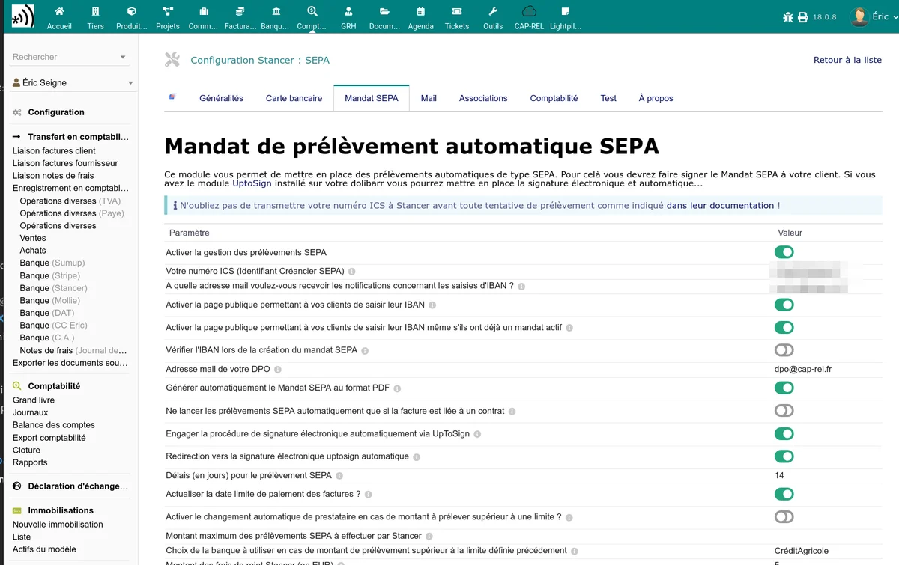
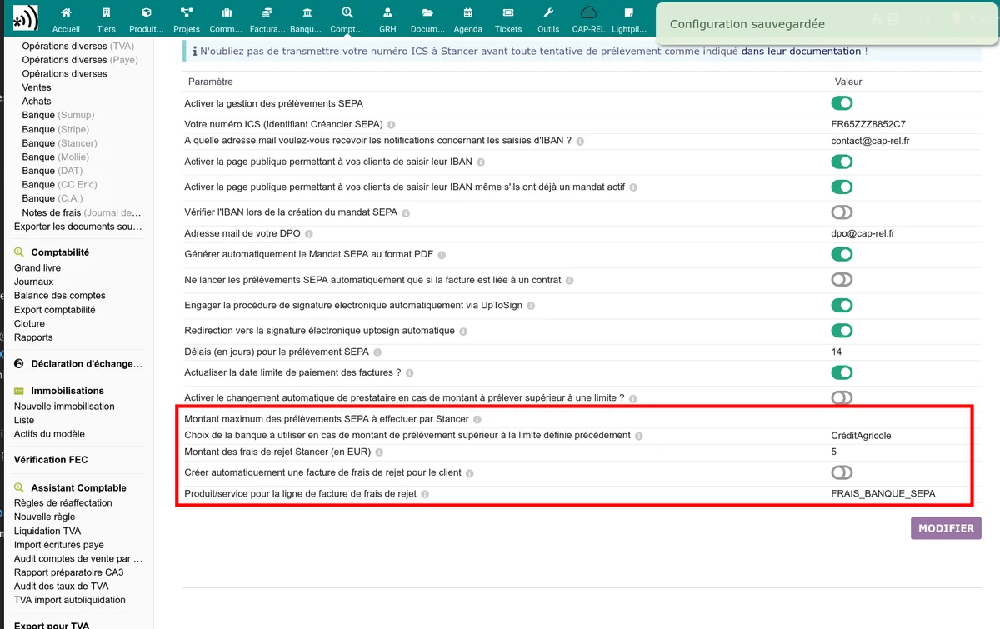

# SEPA direct debits

The Stancer module allows automatically debiting your customers by SEPA direct debit. The configuration is done in the **SEPA mandate** tab of the administration page.

## Enabling

Enable the **Enable SEPA direct debit** option to make this payment method available.

## SEPA Creditor Identifier (ICS)

The **ICS** (SEPA Creditor Identifier) field is mandatory to issue direct debits. This identifier is assigned by your bank. Without an ICS, the module displays a warning and direct debits cannot be issued.

## Public IBAN entry page

The **Enable public IBAN page** option creates a page accessible without login where your customers can enter their IBAN to set up a SEPA mandate.

| Option | Description |
|--------|-------------|
| Public IBAN page | Enables the IBAN entry page for customers |
| Force public IBAN page | Automatically redirects customers to this page if no SEPA mandate is in place |

The customer flow is as follows:

1. The customer accesses the IBAN entry link (sent by email or accessible from the Stancer tab of the thirdparty).
2. They enter their IBAN, their BIC and the account holder's name.
3. The module checks the validity of the IBAN.
4. The SEPA mandate is created on the Stancer platform.
5. A mandate PDF is automatically generated (if the option is enabled).

## IBAN verification (SEPAMail)

The **IBAN verification via SEPAMail** option allows checking that the customer's bank account is reachable for a SEPA direct debit. This verification is only available for French and Italian IBANs.

Possible results are:

| Result | Meaning |
|--------|---------|
| Success | The account is reachable and the direct debit will be possible |
| Warning | The account exists but a potential problem has been detected |
| Pending | Verification is in progress (the bank's response has not arrived yet) |
| Not verifiable | The IBAN type is not covered by SEPAMail |
| Error | The account is not reachable or the IBAN is invalid |
| Account unreachable | The bank could not be contacted via SEPAMail |

## Automatic mandate PDF generation

The **Automatic mandate generation** option creates a SEPA mandate PDF document when a customer registers their IBAN. This PDF is attached to the third-party record and can be sent for signature.

## Electronic signature with UptoSign

If the UptoSign module is installed and enabled in your Dolibarr, two additional options appear:

| Option | Description |
|--------|-------------|
| Automatic sending for signature | The mandate PDF is automatically sent to UptoSign for electronic signature |
| No click | The customer is redirected directly to the signature page without an intermediate step |

> **Note:** electronic signature via UptoSign requires the mandate to have a single signatory. If several signatories are detected, a warning is displayed.

## IBAN notification email

The **IBAN notification email** field allows receiving an email each time a customer registers a new IBAN. Enter the email address that will receive these notifications.

## DPO email

The **DPO email** (Data Protection Officer) field is displayed in the legal text of the SEPA mandate. This field is mandatory for GDPR compliance of the mandate form.

## SEPA notification delay

The **Notification delay** setting (in days) defines how many days before the direct debit the customer is notified. French regulations impose a minimum delay of **14 days**.

The associated **Update invoices** option allows postponing the effective direct debit date on the invoices concerned.

## Restriction to contracts

The **Direct debit only for customers under contract** option limits automatic SEPA direct debit to customers with an active contract in Dolibarr.

## CB / SEPA switch by amount

The module can automatically switch to SEPA direct debit above a certain amount:

| Setting | Description |
|---------|-------------|
| Switch amount | Threshold above which the payment switches to SEPA instead of card |
| Maximum SEPA amount | Ceiling beyond which SEPA direct debit is not offered |
| Alternative bank account | Bank account to use for SEPA direct debits above the threshold |

## SEPA rejection fees

When a SEPA direct debit is rejected by the customer's bank, the module can automatically invoice rejection fees.

| Setting | Description |
|---------|-------------|
| Rejection fee amount | Amount invoiced to the customer in case of rejection (in EUR) |
| Automatic invoicing | If enabled, a fee invoice is automatically created when the rejection is detected |
| Product/service for the fees | Dolibarr product or service used as the line of the fee invoice |

When a rejection is detected:

1. The original invoice is reopened (set back to "Unpaid" status).
2. If automatic invoicing is enabled, a rejection fee invoice is created.
3. A notification email is sent to the customer and the administrator.

> **Important:** the rejection fee invoice is configured to **not** be automatically debited by SEPA, in order to avoid a rejection loop.

### SEPA rejection codes

The module identifies the reason for the rejection thanks to ISO 20022 codes. The most common codes are:

| Code | Meaning |
|------|---------|
| AC01 | Incorrect account number (wrong IBAN) |
| AC04 | Account closed |
| AC06 | Account blocked |
| AG01 | Operation forbidden on this type of account |
| AM04 | Insufficient funds |
| MD01 | No valid mandate |
| MD06 | Debtor dispute (refund requested) |
| MS02 | Reason not specified by the customer |
| MS03 | Reason not specified by the bank |
| RC01 | Invalid BIC |
| SL01 | Specific service requested by the debtor (objection) |

The rejection code detail is displayed in the payment list and in the email notifications.

## Managing mandates from the third-party record

The Stancer tab on a third-party record displays the ongoing SEPA mandates and allows:

- Viewing the registered IBAN (partially masked)
- Copying the public IBAN entry link to send it to the customer
- Deleting a SEPA mandate

