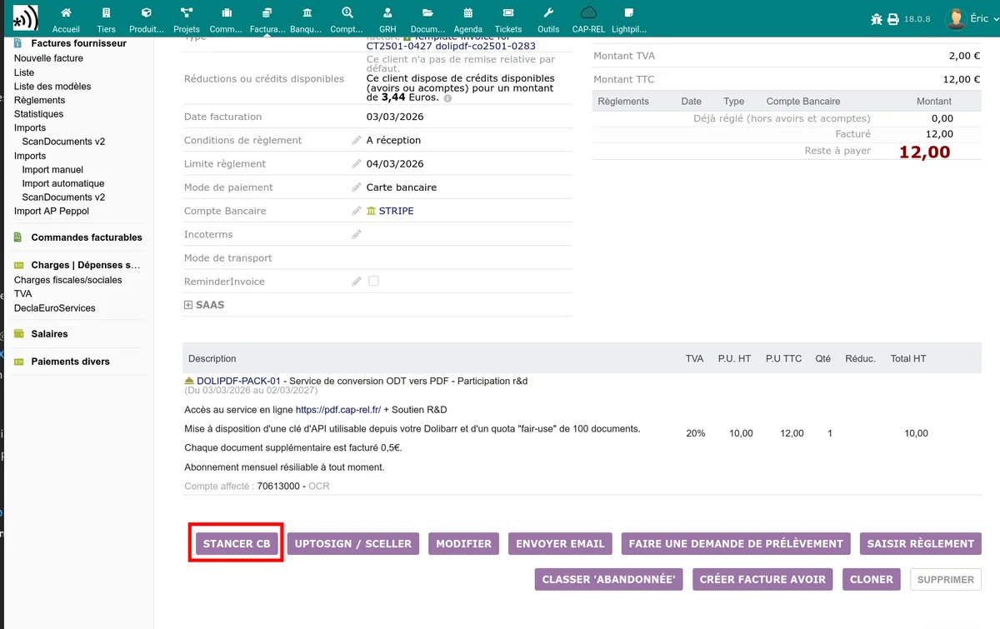

# Payment tracking

The Stancer module adds a **Stancer** menu in the **Bank** section of the left side menu. This menu gives access to four tracking lists and to a dashboard.

## Dashboard

The module home page displays a dashboard with the key indicators:

- **Collections** of the current month
- **Number of payments** captured
- **Refunds** in progress
- **Disputes** open
- **Breakdown by payment method** (card / SEPA)
- **Yearly comparison** of collections
- **Alerts** (recent disputes and refunds)
- **Latest payments** received

> **Note:** in test mode, a warning banner reminds that the displayed data is test data.

## Payment list

Accessible via **Bank > Stancer > Payments**.

This list displays all locally recorded payments, synchronised from the Stancer API. Only payments corresponding to the current mode (test or production) are displayed.

### Displayed columns

| Column | Description |
|--------|-------------|
| Ref. | Stancer payment identifier (`paym_xxx`) |
| Date | Payment date |
| Amount | Payment amount in euros |
| Fees | Stancer commission on this payment |
| Status | Payment status (see below) |
| Response code | Bank response code (for rejections) |
| Invoice / Order | Link to the associated Dolibarr invoice or order |
| Thirdparty | Customer name |

### Payment statuses

| Status | Meaning |
|--------|---------|
| Captured | Payment successfully collected |
| Authorized | Payment authorized, awaiting capture |
| Capture sent | Capture request sent to the bank |
| To capture | Payment awaiting manual capture |
| Disputed | Payment disputed by the customer |
| Expired | Authorization expired without capture |
| Failed | Payment failed (technical error) |
| Refused | Payment refused by the bank |

### Refresh button

The **Refresh** button at the top of the list triggers a synchronisation with the Stancer API:

1. Retrieval of new payments from the API.
2. Status check of local payments pending.
3. Deletion of obsolete payment drafts.

> **Important:** synchronisation is only triggered by this button or by the [scheduled tasks](/stancer/taches-automatiques). Navigating and filtering the list do not trigger any API call.

## Payout list

Accessible via **Bank > Stancer > Payouts**.

A payout corresponds to the transfer made by Stancer to your bank account. It groups the payments collected over a given period, minus the commissions.

### Displayed columns

| Column | Description |
|--------|-------------|
| Ref. | Stancer payout identifier |
| Date | Transfer date |
| Amount | Amount transferred to your bank account |
| Status | Payout status |

The **Refresh** button synchronises the payouts from the API and creates the corresponding bank transfer transactions in Dolibarr (from the Stancer account to your main account).

> **Note:** payouts are not available in test mode.

## Refund list

Accessible via **Bank > Stancer > Refunds**.

This list displays the refunds made from Stancer to your customers.

When a refund is confirmed, the module:

1. Reopens the associated invoice (set back to "Unpaid" status).
2. Sends a notification to the administrator.

### Creating a refund

From the record of a captured payment, you can initiate a refund:

1. Open the payment in the list.
2. Click **Refund**.
3. Enter the amount to refund (full or partial).
4. Confirm.

The refund is sent to the Stancer API and will appear in the list after synchronisation.

## Dispute list

Accessible via **Bank > Stancer > Disputes**.

A dispute occurs when a customer contests a payment with their bank.

When a dispute is lost (statuses: lost, accepted, out of time, not contestable), the module:

1. Reopens the associated invoice (set back to "Unpaid" status).
2. Sends a notification email to the administrator and the customer.
3. Creates a rejection fee invoice if the option is configured (see [SEPA direct debits](/stancer/sepa)).

The **Refresh** button synchronises the disputes from the Stancer API.

## Result of each payment in the invoice events

Each Stancer payment attempt on an invoice leaves an event in the **Events** tab of the invoice, with the same conventions as the Stripe direct debits of the Dolibarr core:

| Event code | Meaning |
|---|---|
| `AC_PAYMENT_STANCER_OK` | The payment was collected by Stancer and recorded on the invoice |
| `AC_PAYMENT_STANCER_KO` | Stancer refused the payment, let it fail or expire, or the customer disputed it |

These events are of type "Automatic event" (`AC_OTH_AUTO`), attached to the thirdparty and the invoice. There is only one per Stancer payment and per invoice: daily synchronisations, the customer's return on the payment page and the dispute synchronisation do not create it a second time. The Stancer payment identifier (`paym_...`) is kept in the external reference of the event.

For a failure, the event date is that of the failure at Stancer when known (card refusal, dispute date), otherwise that of its detection. The complementary parameters field contains the Stancer status, the response code and its explanation, separated by " - ", for example `disputed - AM04 - Provision insuffisante`.

A payment collected then disputed carries both events. The payment of an order or a quote does not create any as long as there is no invoice: the success event is set on the invoice created from the order or the quote, a failure before invoicing leaves none.

Other modules can rely on these codes as on those of Stripe, for example to space out new direct debit attempts or to suspend a service after several failures. A rule that looks for `AC_PAYMENT_%_KO` in `llx_actioncomm` (filtered on `elementtype = 'invoice'` and `fk_element`) thus covers both Stripe and Stancer.

The module's historical events are still created as before: invoice reopening (`AC_BILL_REOPEN_FAILED_...`), notification to the administrator (`AC_ADMIN_PAYERROR_...`), sent emails and `AC_STANCER_PAYMENT_OK`, which indicates that the payment and its bank line have been recorded.

## Stancer tab on the third-party record

Each third-party record has a **Stancer** tab that centralises the customer's payment information:

- **Stancer customer account**: customer identifier at Stancer
- **Saved credit cards** (type, last digits, expiry)
- **Ongoing SEPA mandates** (partially masked IBAN)
- **Public links**: URL of the IBAN entry page and of the card registration page

From this tab, you can:

- Create or link a Stancer customer account
- Save a credit card
- Save a SEPA mandate
- Delete a SEPA mandate
- Synchronise the SEPA mandates with Stancer: the **Synchronise SEPA mandates with Stancer** button completes a missing BIC and checks each of the thirdparty's mandates with Stancer. Displaying the tab no longer modifies anything, this check is only done by this button, reserved for users with the module write right
- Copy the public links to send them to the customer

## Payment buttons on records

The module adds action buttons on the records of several Dolibarr objects:

- **Invoice**: button to launch a card or SEPA payment
- **Order**: button to send a payment link
- **Quote**: button to send a payment link (if configured)

These buttons are visible to users having the "Create/modify Stancer data" permission.

