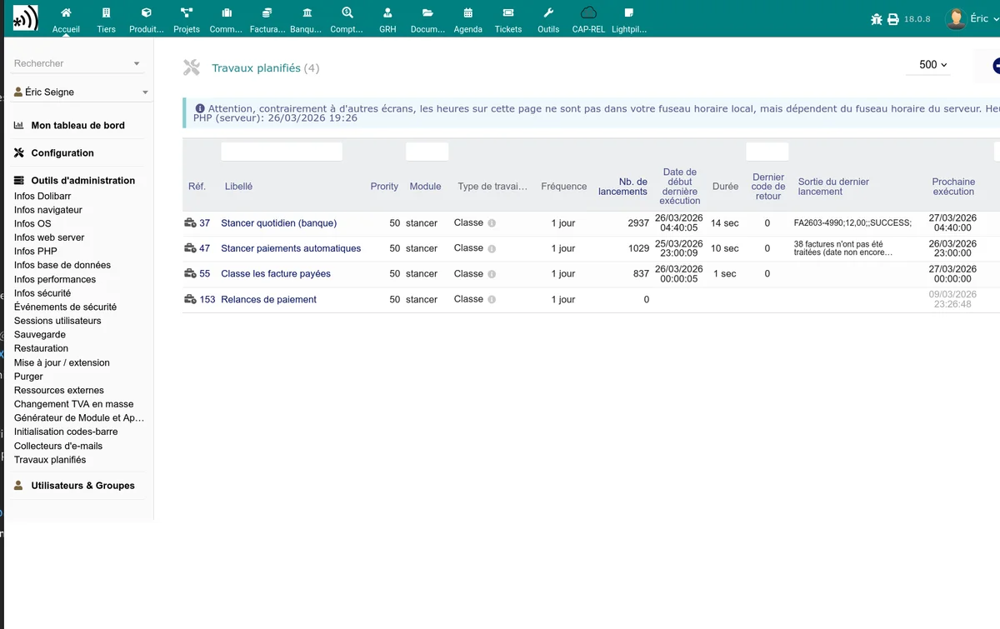

# Automatic tasks

The Stancer module registers five scheduled tasks in the Dolibarr cron task manager. By default, they are all **disabled** and must be enabled manually.

Access the scheduled tasks in **Home > Setup > Scheduled tasks** and look for the tasks starting with "Stancer".

## Payment and payout synchronisation

**Task name**: StancerCheckPay

This task performs the same operation as the "Refresh" button of the payment and payout lists:

1. Retrieves the new payments from the Stancer API.
2. Checks the status of local payments pending.
3. Retrieves the new payouts.
4. Deletes obsolete payment drafts.

**Recommended frequency:** daily (once a day). The task is configured by default to run at a random hour between 0 am and 6 am.

> **Tip:** if you process a large volume of payments, you can increase the frequency to several times a day. For moderate use, a daily run is enough.

## Automatic invoice direct debit

**Task name**: StancerCheckTakePayments

This task looks for overdue unpaid invoices and automatically launches the payment (card or SEPA) for customers having a registered payment method.

The process is as follows:

1. Search for unpaid invoices whose due date has passed.
2. For each invoice, check whether the customer has an active credit card or SEPA mandate.
3. Launch the payment via the Stancer API.
4. Record the result (success or error).

**Recommended frequency:** daily.

> **Important:** this task respects the SEPA configuration settings (notification delay, contract restriction, CB/SEPA switch amount). Check your [SEPA configuration](/stancer/sepa) before enabling it.

## Paid invoice check

**Task name**: StancerCheckInvoicesPaid

This task checks recent payments and marks the corresponding invoices as "Paid" if the total amount has been collected. It acts as a safety net for invoices that would not have been marked automatically when the payment was received.

**Recommended frequency:** daily.

## Sending reminders

**Task name**: StancerSendPaymentReminders

This task sends reminder emails to customers whose payment failed, according to the schedule and templates (soft, firm, monthly) defined in the [notification configuration](/stancer/notifications). It scans failed payments less than 6 months old and automatically chooses the right email template according to the reminder rank.

**Recommended frequency:** daily.

> **Note:** reminders are only sent if the option is enabled in the Mail tab of the configuration. A summary of the reminders sent can be sent to the administrator if the option is checked.

## Automatic sending of invoices at validation (deferred)

**Task name**: StancerSendPendingValidationMails

This task automatically emails validated invoices whose grace delay has passed, unless they were sent manually in the meantime. It does nothing if the **Email the invoice at validation** option is not enabled or if the delay is 0 (immediate sending without deferral).

At each run, the task:

1. Looks for scheduled sendings whose deadline has passed.
2. Cancels the sending if the invoice is no longer validated (draft, abandoned, deleted).
3. Cancels the sending if the invoice was sent manually after scheduling.
4. Otherwise, sends the email to the customer via the configured template and marks the sending as done.

**Recommended frequency:** hourly (default).

> **Note:** the list of pending sendings is visible in the Stancer dashboard.

## Enabling and configuration

To enable a scheduled task:

1. Go to **Home > Setup > Scheduled tasks**.
2. Click the Stancer task to enable.
3. Set the status to **Enabled**.
4. Configure the desired execution frequency.
5. Save.

> **Prerequisite:** the Dolibarr cron must be configured on your server for the scheduled tasks to run. See the Dolibarr documentation for system cron configuration.

## Execution order

The tasks run independently, but the recommended logical order is:

1. **StancerCheckPay** (synchronisation) -- to have up-to-date data
2. **StancerCheckTakePayments** (direct debit) -- to launch the payments
3. **StancerCheckInvoicesPaid** (check) -- to mark paid invoices
4. **StancerSendPaymentReminders** (reminders) -- to follow up failures
5. **StancerSendPendingValidationMails** (deferred sending at validation) -- to send invoices whose grace delay has passed

In case of an error during synchronisation (for example, an API authentication error), the following tasks in the chain are not blocked because they are independent. Each task handles its own errors and logs them in the `dolibarr.log` file.
